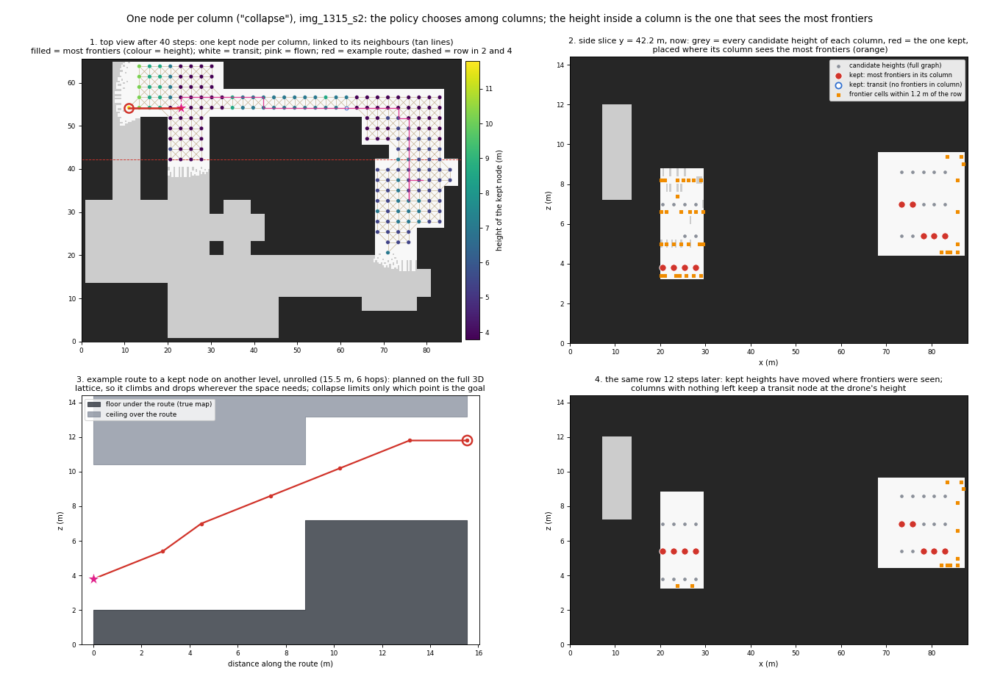

# One node per column ("collapse")

How the learned 3D planner keeps its graph at 2D size. This is what the pruning study
(`scripts/prune_study.py`, strategy `collapse`) measured, and what the first 3D training runs will use
(see `docs/PLAN_3D.md` in hirotakayin/large-scale-DRL-exploration, branch 3d-learning).

Figure (made on an ari3d_v3 world, generator at commit 4de5d80): `scripts/column_graph_figure.py --world ~/mission_runs/ari3d_v3/img_1315_s2 --step 40 --later 12 --out docs/column_graph.png`.
It runs the study's simulator, freezes it after 40 steps, and draws what it actually holds. It is not a sketch.

## The problem it solves

ARiADNE (2D) puts a node every 4 m on known free space. The policy, an attention network, reads every node and
picks the next one to fly to among the current node's neighbours. In 3D the same idea gives a node every few
metres in x, y and z: a lattice. In the study (2.4 m across, 1.6 m vertically) that was 1,200–1,530 nodes per
world against 370–410 columns, 3 to 4 times more nodes. ARiADNE pads its graph to 360 nodes, and the network's
cost grows with the node count.

## Terms

- **Lattice node**: a point on the 3D grid (x, y every `xy` m, z every `z` m) that lies in known free space with
  room for the drone. Free space is checked in configuration space: free cells at least one voxel from anything
  occupied or unknown.
- **Column**: all lattice nodes with the same (x, y). It is a vertical stack of candidate heights, up to
  about 12 in a 14–20 m tall world. Solid ground and walls leave gaps in the stack.
- **Utility of a node**: how many frontier cells it would see. A frontier cell is a known free cell next to an
  unknown one, grouped on a 1.6 m grid. A frontier counts when it lies within 0.8 × sensor range (12.8 m), inside
  the tilted Mid-360's elevation band (−30.5° to +75.5° from horizontal), and with a clear line of sight through
  known free space. This is ARiADNE's utility with a 3D sensor. `MIN_UTILITY = 2`: fewer counts as nothing.

## The rule: which node a column keeps

At every step, after the drone scans, each column keeps exactly one node (`Sim.sets()` in `prune_study.py`):

1. If any node in the column has utility of at least `MIN_UTILITY`, keep the one with the **highest utility**.
   That is the height in the column that would see the most unexplored space.
2. Otherwise keep a **transit node**: the column's node closest to the drone's current height. It keeps the
   column usable as a waypoint at a height the drone can already fly.

The choice is redone every step. When the frontiers at one height have been seen, that node's utility drops
and another height in the column takes over. In the figure, panels 2 and 4 show the same row 12 steps apart:
in the room at x = 20–28 m the kept height moves from 3.8 m to 5.4 m once the low frontiers are seen.

## What "one node per column" means, and what it doesn't

It limits **where the drone can choose to go next**. It does not limit **how the drone gets there**.

- **Still many candidate paths.** Every column keeps a node, so the policy still sees the whole network of
  columns, linked to their neighbours as in 2D ARiADNE (tan lines in panel 1). It chooses among routes across
  the map as before.
- **Routes use every height.** The path to the chosen node is planned on the full 3D lattice. It climbs over
  low islands, drops into pits and passes under lintels wherever the space needs it. Panel 3 unrolls one such
  route: 15.5 m long, climbing 8 m from the drone's height up onto a raised level.
- **What is lost.** At one step, the policy cannot choose between two heights in the same column, for example
  the floor of a pit and the air above it. It is only offered the height with more frontiers. The other height
  comes back as the kept node once the first one's frontiers are seen. In the study this cost about 9% extra
  distance (−2% to +16% by world). The most-utility height was within 5% of the best move in 60–74% of steps.
  A learned height choice, stage 2 of the plan, is meant to win some of that back.
- **What it is not.** It is not a 2D planner at a fixed altitude: the kept heights differ from column to
  column and change over time. It is not slicing either. Slicing kept one node per 5 m piece of each column; it
  kept more nodes and cost more distance.

## How this goes into the trainer (planned, not built yet)

- Columns every 4 m (ARiADNE's `NODE_RESOLUTION`), so ari3d worlds (ARiADNE's own scale) have about 140–200 columns. That
  fits ARiADNE's 360-node padding.
- Node inputs grow from 4 (x, y, utility, visited) to about 7: the kept height relative to the drone, the number
  of separate free gaps in the column, and the column's free height.
- Two columns are linked when they are neighbours (within the policy's 25 nearest) and a route between their
  kept nodes exists on the full lattice. Edge length = that route's length, not the straight line.
- The ground-truth critic (ARiADNE's "ground truth node manager") gets the same column graph built on the true
  map.

## Where the numbers come from

`scripts/prune_study.py` on four ari3d_v3 worlds (`make_ari3d.py --pngs img_1609 627 img_1315 img_4537 --seed 0` at
commit 4de5d80, before staggers and split corridors were added),
with a greedy explorer (best utility per metre of route) standing in for the policy, teleporting between nodes,
and routes on the full lattice for every strategy. Results and charts: claude.ai artifact "3D node pruning study".
